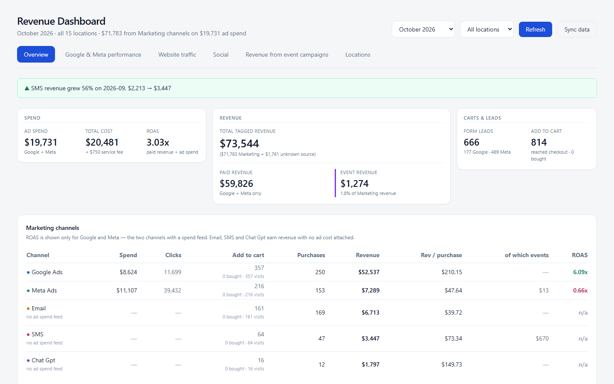
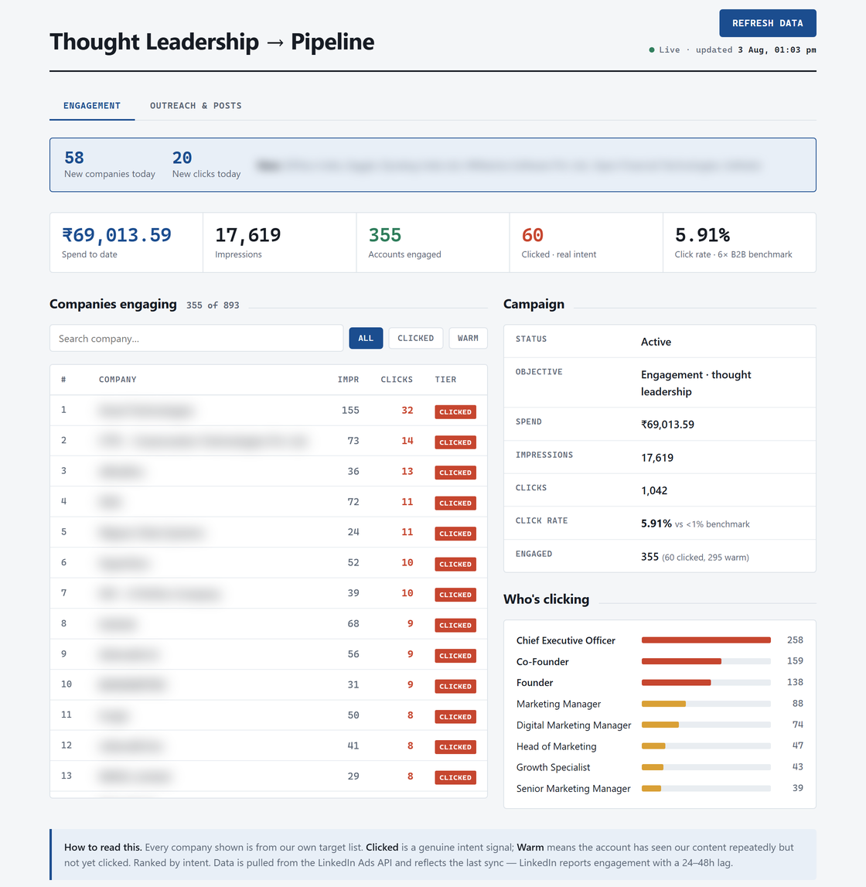

# Hi, I'm Vinay 👋

Growth and performance marketer with 6+ years in B2B SaaS and fintech. I also build the tools I run campaigns with.

I started on paid ads, moved into product marketing at Volopay, then began writing my own dashboards because waiting on reports slowed everything down. Now I use Claude Code to turn repetitive marketing work into software. The AI does the building, and I set the rules and approve the output.

Stack: Python • FastAPI • Claude Code • Google, Meta and LinkedIn Ads APIs • GA4

💼 Open to growth, performance and product marketing roles.

[Portfolio](https://vinaykumar.work) • [LinkedIn](https://www.linkedin.com/in/vinaykumardm) • [X](https://x.com/visuallyvinay)

## Results

- **Volopay (YC S20):** ran GTM across 4 APAC markets, contributing $2.5M+ to ARR growth
- **Volopay paid funnels:** lead costs down 68%, lead volume up 120%
- **Itilite:** leads up 36%, qualified opportunities doubled
- **Identity and fraud company:** lead-to-MQL rate up 38% in the top-performing segment over 3 months
- **Ad operations tools:** monitoring and campaign pushes across 7 ad accounts, execution time down 96%

## Projects

Screenshots use made-up brands and numbers unless a project says otherwise. No client data is in the public repos.

### Revenue dashboard (private client project, no public repo)

Live dashboard for a 15-location US business. Ad platforms only report their own conversions, so it ties each booked purchase back to its UTM tag and shows revenue against spend by channel, location and month.

**9 sources connected, synced every night**

| Source | What it adds |
|---|---|
| Google Ads API | 14 accounts: spend, clicks, conversions |
| Meta Marketing API | 18 accounts: spend, clicks, conversions |
| GA4 Data API | 11 properties: traffic and funnel |
| Instagram | Follower counts for linked accounts |
| Google Sheets (5) | Purchases, add-to-cart, Google form leads, Meta form leads, UTM classification |

**How it tracks UTMs**

- Covers 108 UTM sources and 380 source, medium and campaign combinations across 24,000+ purchase lines
- Reads a 200+ row classification sheet live, so a change to the sheet shows up on the next refresh
- Sorts inconsistent tags like `ig`, `insta` and `Instagram_Feed` into the right channel by source family when a tag isn't in the sheet
- Flags new tags as unclassified and keeps them out of channel totals
- Shows revenue from email, SMS and ChatGPT, which no ad platform reports

**Where the complexity is**

- Purchases only count if they carry a UTM source, so untagged walk-ins never inflate ROAS
- Revenue is parsed out of a free-text product field, because the deposit and quantity columns give wrong totals
- Repeat records from the booking system are hidden only when customer, amount and products match within 120 seconds, so real repeat customers stay
- Customers are matched on a hashed email or phone, and raw values are never stored
- Accounts that moved are summed by location, and new Meta accounts are picked up automatically
- ROAS and net ROI are recalculated from raw rows, never read from a sheet

About 4,000 lines of Python on FastAPI and SQLite.

### linkedin-predictor

[linkedin-predictor](https://github.com/vinay123kum/linkedin-predictor) forecasts LinkedIn Ads problems before they cost money: CPL trends, creative fatigue and InMail saturation.

### AEO/GEO audit pipeline (private repo)

Buyers now ask AI tools instead of searching, and a page can rank on Google without ever being cited in an AI answer. A content team can't check hundreds of URLs by hand, so this finds which pages to fix first and what competitors do better.

- **Discover:** reads a domain's robots.txt and sitemaps and pulls every content URL
- **Categorize:** sorts each URL by content type, intent and topic, then gives it a priority score
- **Audit:** scores each page against 31 AEO/GEO criteria, with a grade, critical failures and top fixes
- **Report:** one HTML summary per run, so you can compare your domain with competitors

Point it at your own site for a rewrite list, or at a competitor's to see which pages set the bar.

### ABM thought leadership tracker (private client project)

One platform for marketing and sales outreach. It tracks a LinkedIn campaign against 893 target companies, then ranks who to contact next at the accounts that clicked.

- 355 of 893 target companies engaged: 60 clicked, 295 warm
- 181 named follow-ups ranked, with people already approached removed
- 5.91% click rate against a sub-1% B2B benchmark

[Read the full case study](https://vinaykumar.work/abm-thought-leadership-tracker.html)

### More

**Ads**
- [google-ads-operator](https://github.com/vinay123kum/google-ads-operator): Google Ads audit scripts and a Slack bot, with a human approving changes
- [creative-qa-checker](https://github.com/vinay123kum/creative-qa-checker): uses Claude to check videos and static ads for mistakes before they go out
- [reel-builder](https://github.com/vinay123kum/reel-builder): cut 300 mostly identical Reels a month down to 3 to 4 minutes each, using templates taught on past videos

**AI search and SEO**
- [aeo-checker](https://github.com/vinay123kum/aeo-checker): takes one URL and scores how often AI answers cite that brand against its competitors
- [llm-visibility-tracker](https://github.com/vinay123kum/llm-visibility-tracker): tracks brand citations across LLMs
- [seo-competitive-intel](https://github.com/vinay123kum/seo-competitive-intel): AI visibility gap report against competitors

**Websites and research**
- [website-error-finder](https://github.com/vinay123kum/website-error-finder): crawls a site, runs browser tests and gives you a prioritised list of what's broken
- [creator-scout](https://github.com/vinay123kum/creator-scout): finds and scores YouTube and X creators with evidence, and never sends outreach itself
- [nse-stock-screener](https://github.com/vinay123kum/nse-stock-screener): screens NSE small and mid caps, not investment advice

Built with Claude Code. I set the design and rules and review the output.
